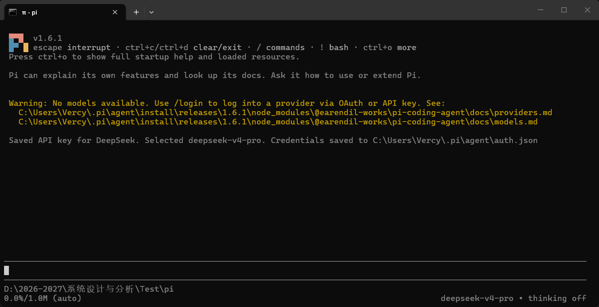
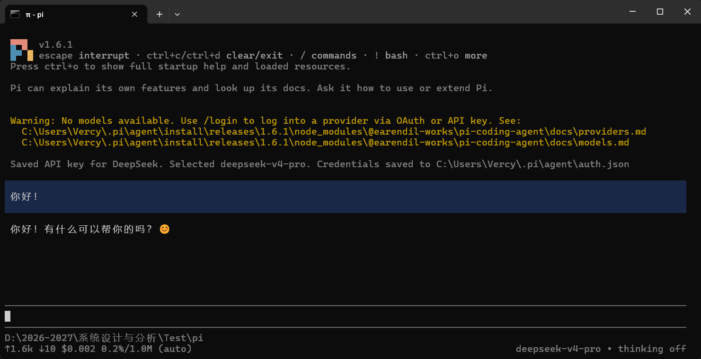
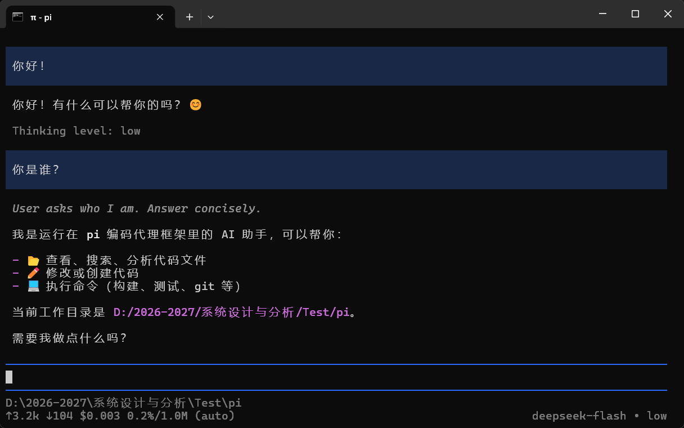
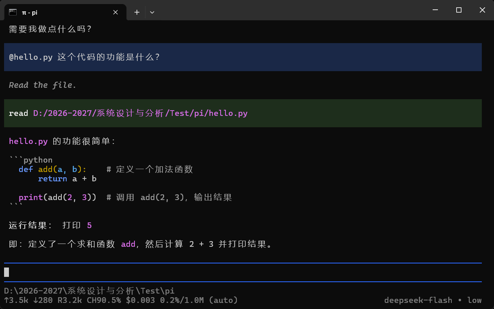
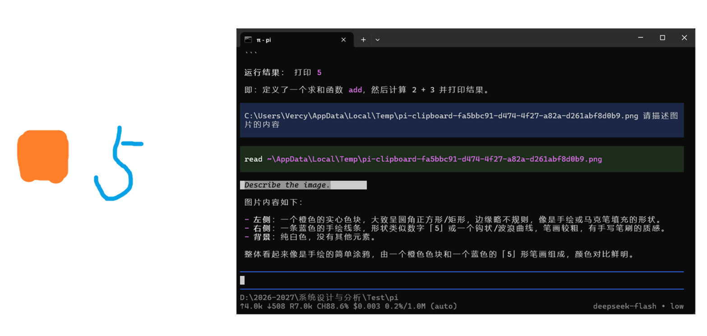
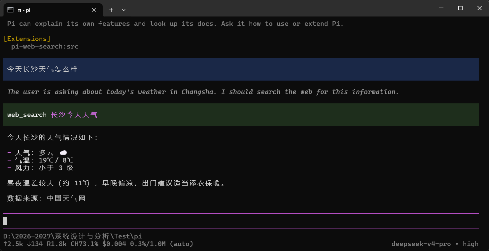

## Practice01：Pi Agent 安装与基础使用指导

1、显示 Pi 已成功启动、版本信息和当前工作目录  

2、包含自己发出的提示词、模型实际回复和当前模型信息  

3、显示模型切换前后名称及思考级别切换前后状态，可用两张截图组合证明  

4、显示引用的文件名、问题和实际回复  

5、显示已附加图片的提示、问题和实际回复  

6、安装成功输出、重新运行 pi 后的加载信息，以及一次插件功能调用结果  
